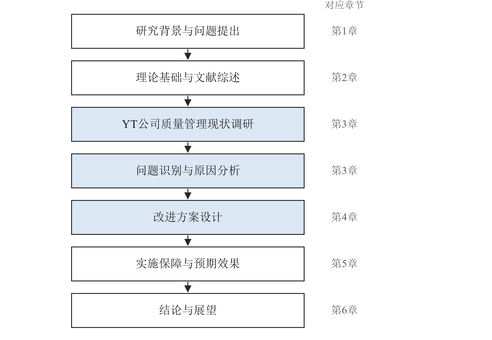

# 第1章　绪论

> 示例章节（虚构企业 YT 公司），只写到足以演示源稿约定的程度。

## 1.1　研究背景与意义

汽车零部件配套企业面临整车厂对质量与交付的持续加压，质量问题一旦流出到客户端，带来的不只是补货和索赔，还有供应资格的风险。中小配套企业普遍通过了质量管理体系认证，但质量工作仍以检验把关为主[2]，预防性的管理手段落地不足。YT 公司体系认证多年，客户投诉却居高不下，具有一定的代表性。

本文的意义在于：为同类中小制造企业改进质量管理提供一个从全过程视角出发的分析框架；为 YT 公司的质量管理提供可实施的方案。

## 1.2　研究内容与研究方法

本文采用文献研究法、案例分析法和实地调研法。文献研究法用于梳理全面质量管理和质量成本领域的研究进展；案例分析法以 YT 公司为对象展开；实地调研法用于获取企业的一手资料。研究技术路线如图 1.1 所示。

【图 1.1　技术路线图】
> 资料来源：作者绘制。

## 本章待补数据与待确认事项

- [参考文献] 1.1 第一段行业质量要求的出处
