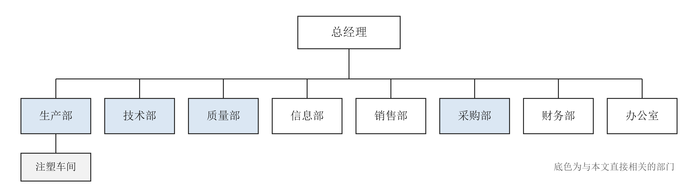
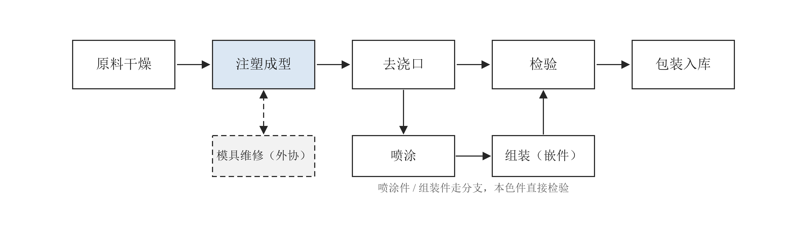
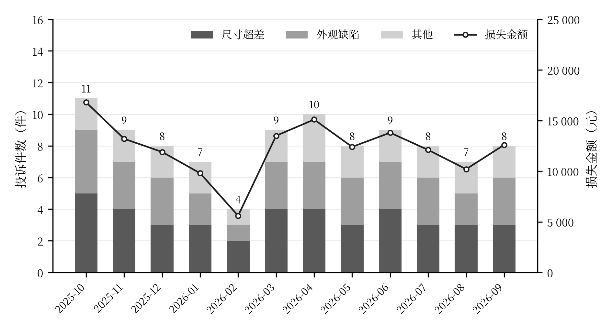

# 第3章　YT公司质量管理现状与问题分析

> 示例章节：YT 公司是虚构的汽车内饰注塑件企业，全部数据均为编造，仅用于演示源稿约定与写法。
> 初稿 v0.1　2025-03-20　依据：示例《数据解读》
> 脱敏口径：不出现企业全称、客户名称、设备型号与供应商名称；营收写区间。

## 3.1　YT公司概况

YT 公司成立于 2000 年代初，位于华东地区，是一家为整车厂二级配套的汽车内饰注塑件制造企业，产品包括仪表台饰板、门板扣件、空调出风口格栅等，至今已在该领域经营二十余年。公司通过 IATF 16949 质量管理体系认证，拥有覆盖原料干燥、注塑成型、去浇口、喷涂、组装与检验的完整生产线，现有员工约 180 人，其中质量部 12 人，属于中小企业中的中型企业。公司现有注塑机 24 台，年营业收入处于 1 亿元至 2 亿元区间。近年来整车厂对配套件的质量与交付要求持续提高，公司降本与稳定质量的压力随之加大。

公司产品以中小型内饰件为主，按工艺可分为本色件、喷涂件和带嵌件的组装件三类，其中本色件占比最高。三类产品均须经过注塑成型，注塑是所有产品共同的核心工序。主要品类的产销结构如表 3.1 所示。

【表 3.1　YT公司主要产品结构与产能利用情况】

| 品类 | 年产能（万件） | 上年实际产量（万件） | 产能利用率 | 品类占比 | 结构特征 |
|---|---|---|---|---|---|
| 本色件 | 1200 | 912 | 约 76% | 58.3% | 注塑后直接组装或发货 |
| 喷涂件 | 500 | 406 | 约 81% | 26.0% | 注塑后增加喷涂工序 |
| 组装件 | 300 | 246 | 约 82% | 15.7% | 含金属嵌件，注塑后组装 |

> 资料来源：YT 公司提供（示例数据）。品类占比为企业统计口径。

公司客户为三家整车厂的一级供应商，前两家合计占营业收入的六成以上，客户结构较为集中。整车配套的特点是项目周期长、批量稳定，但对质量和准时交付有强制要求，客户每年的供应商审核中，质量绩效是决定后续定点的主要依据。公司组织结构如图 3.1 所示，生产、技术、质量、采购四个部门与本文直接相关。

【图 3.1　YT公司组织结构图】
> 资料来源：作者根据企业提供资料绘制。

## 3.2　YT公司质量管理现状

### 3.2.1　核心生产流程与质量控制点

YT 公司的生产以注塑成型为中心。原料经干燥后进入注塑机，依据模具与工艺参数成型，脱模后去除浇口，本色件直接进入检验与包装，喷涂件转入喷涂线，组装件转入组装工位。模具维修委托外部厂家完成。核心流程如图 3.2 所示。

【图 3.2　YT公司注塑生产流程图】
> 资料来源：作者根据实地调研绘制。

公司在来料、注塑、喷涂、组装和成品五个环节设有质量控制点，检验方式和执行情况差异较大，如表 3.2 所示。

【表 3.2　YT公司各环节质量检验现状表】

| 环节 | 检验方式 | 执行人员 | 记录方式 | 执行情况 |
|---|---|---|---|---|
| 来料 | 按批抽检 | 质量部来料检验员 | 纸质记录 | 抽检比例约 5%，紧急来料常先放行后检验 |
| 注塑成型 | 首件检验 + 巡检 | 班组长、质量部巡检员 | 纸质记录 | 首件检验按规定执行的约占六成 |
| 喷涂 | 巡检 | 质量部巡检员 | 纸质记录 | 每班 2 次 |
| 组装 | 操作工自检 | 操作工 | 无记录 | —— |
| 成品 | 外观全检 + 尺寸抽检 | 质量部成品检验员 | 质量台账（Excel） | 按出货批次执行 |

> 资料来源：实地调研整理（示例数据）。
> 写作备注：这一行是备注，不会输出到 Word。

### 3.2.2　YT公司质量管理体系运行现状

公司于 2010 年代中期通过质量管理体系认证，体系文件齐全，内审和管理评审每年各开展一次。质量部现有 12 人，其中检验员 9 人，质量工程师 3 人，日常工作以检验和处理客户投诉为主。质量目标只在质量部层面分解，生产班组的考核指标以产量和交期为主。报废、返工和客户补货产生的费用分别计入生产成本和销售费用，公司没有单独核算质量成本 [需补充：近两年内审发现项的整改情况]。

## 3.3　YT公司质量管理存在的问题

### 3.3.1　来料质量控制薄弱

公司的树脂粒料、金属嵌件和涂料来自 30 余家供应商，来料检验按批抽检，抽检比例约为 5%，遇到生产急用时常先投产后补检。供应商的选择以价格和供货能力为主，进入合格供应商名录后没有定期的质量评价，也没有退出机制。

来料问题因此往往在注塑或喷涂之后才暴露。据企业统计，上年因来料原因造成的批量不良共 14 起，其中粒料含水率超标与嵌件尺寸偏差合计 11 起 [需补充：企业统计口径]。批量不良发生后，已投产的半成品只能报废或返工，损失远大于来料本身的价值。

### 3.3.2　过程检验流于形式，质量依赖末端把关

注塑件的尺寸与外观缺陷大多可以在首件和巡检环节发现。公司规定每次开机和换模后须做首件检验，但抽查近三个月的记录，按规定执行的约占六成；巡检记录多在班次结束时集中补填，记录内容与实际巡检时间对不上。组装工序只有操作工自检，没有任何记录。

过程检验失守之后，质量只能依靠成品检验把关。上年公司内部报废率约为 2.8%，内部发现的不良中约七成是在成品检验环节才被发现的，此时整批产品已经完成全部工序。成品检验对尺寸只做抽检，仍有部分不良流出到客户端。

### 3.3.3　客户投诉处理缺乏闭环

近 12 个月公司共接到客户投诉 98 件，月度分布与损失金额如图 3.3 所示。投诉以尺寸超差和外观缺陷为主，两类合计占 75.5%，这两类缺陷本应在过程检验中被拦截。

【图 3.3　YT公司近 12 个月客户投诉件数与损失金额】
> 资料来源：YT 公司客诉台账（示例数据）。

投诉处理以满足客户的临时要求为目标。实际处理中，多数投诉以公司补货了结，真正查明原因并形成纠正措施的不足三成，纠正措施实施后是否有效也没有人跟踪验证。同一产品、同一缺陷在不同月份重复被投诉的情况并不少见。

### 3.3.4　质量成本缺乏统计与分析

公司没有质量成本的统计口径，报废、返工、补货和客户索赔分散在不同的费用科目中。仅图 3.3 所示的客户投诉损失，近 12 个月合计就达 14.7 万元，而内部报废与返工的损失从未被单独统计。管理层无法判断质量损失的规模和构成，也就难以评估预防投入是否值得。

## 3.4　YT公司质量管理问题的原因分析

### 3.4.1　供应商质量管理制度不健全

来料质量控制薄弱的主要原因，在于公司没有建立覆盖供应商准入、评价和退出的质量管理制度。供应商准入时只看报价和供货能力，不做质量体系审核；进入名录后没有按来料合格率等指标定期评价；来料问题发生后也只是退货或索赔，不要求供应商分析原因、提交整改报告。来料检验因而成了拦截问题的唯一手段，而 5% 的抽检比例难以承担这一角色。

### 3.4.2　质量责任未落实到生产岗位

过程检验流于形式，根源在于质量被看作质量部一个部门的事，生产岗位没有承担相应的质量责任。班组考核只看产量与交期，首件检验做与不做对班组长的考核没有影响；巡检员人数有限，只能抽查少数机台，事后补填记录也没有人核查。在这样的责任安排下，过程控制自然让位于产量，质量只能依靠末端检验兜底。

### 3.4.3　纠正预防机制缺失

客户投诉处理缺乏闭环，直接原因是公司对投诉只要求"给客户一个交代"，更根本的原因是没有建立纠正与预防机制。公司没有规定投诉必须经过原因分析、纠正措施和效果验证三个步骤，结构化的问题分析报告只在客户明确要求时才做；纠正措施由谁执行、何时完成、如何验证均无规定。按 PDCA 循环的要求，公司的投诉处理停在了"执行"阶段，"检查"和"处理"两个阶段缺位，同类问题因而反复出现。

### 3.4.4　质量成本核算体系缺失

质量成本缺乏统计，原因在于财务核算没有设置质量成本科目，质量部也没有建立相应的统计台账。预防成本、鉴定成本、内部损失和外部损失四类费用无从归集，管理层看到的只是分散在各科目里的零星数字。缺少这一依据，质量改进的投入就难以进入管理层的决策视野，质量管理也就长期停留在事后检验的层面。

## 本章待补数据与待确认事项

- [需补充] 3.2.2 近两年内审发现项的整改情况
- [需补充] 3.3.1 "来料批量不良 14 起"的统计口径，需企业确认
- [待确认] 3.3.2 首件检验执行率约六成的抽查范围与期间
- 本节及以后的内容不会输出到 Word
